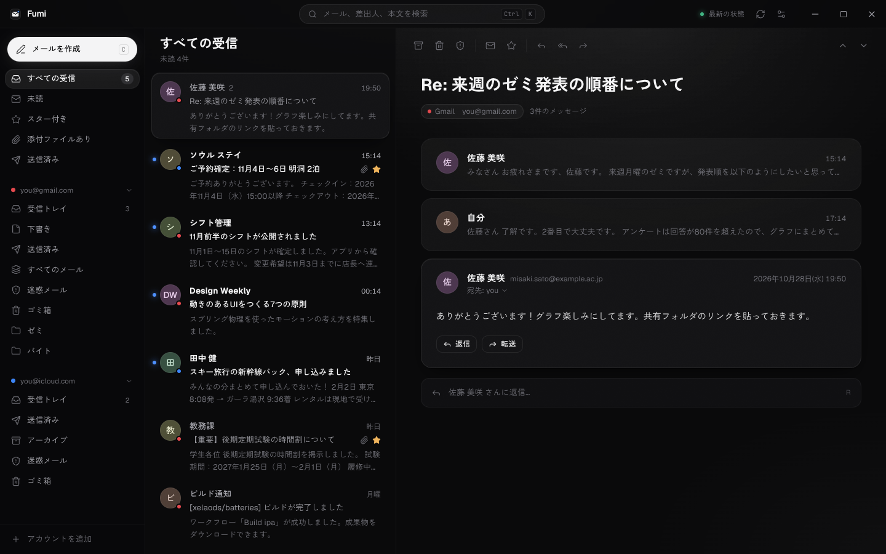
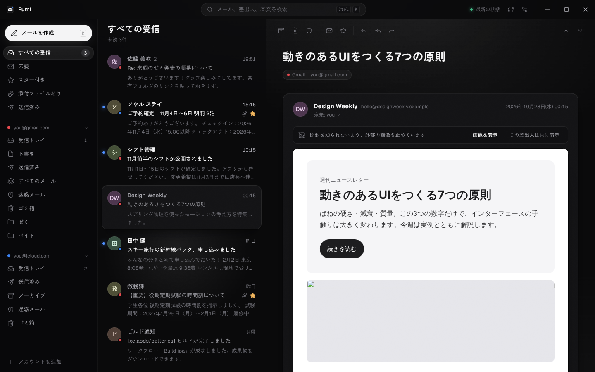
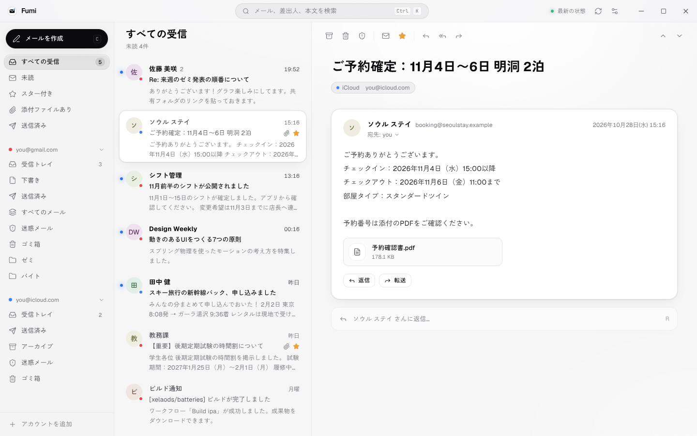

# Fumi

Gmail と iCloud メールを、ひとつの受信トレイで速く・気持ちよく読むための Windows 用メールクライアントです。
UI は [EasyUI](https://easyui.site) のデザインシステム（モノクロームの階調・角丸・スプリングアニメーション）を土台に、深い暗部と光の演出を加えています。書体は欧文が Geist、和文が Zen Kaku Gothic New です。



## できること

- **統合受信トレイ** — Gmail と iCloud を並べて表示。アカウントは色のドットで見分けられます
- **スレッド表示** — 返信のやり取りを1つの会話にまとめ、送信済みの自分の返信も一緒に表示
- **即時プッシュ** — IMAP IDLE で新着を待ち受け、届いた瞬間に一覧と Windows 通知へ
- **瞬時の一覧・全文検索** — 同期したメールはローカル（SQLite + FTS5 trigram）に保存。日本語の部分一致検索にも対応
- **キーボード操作** — J/K で移動、E でアーカイブ、R で返信、Ctrl+K でコマンドパレット（一覧は `?`）
- **取り消し** — アーカイブ・削除・送信はすべて数秒間取り消し可能（Ctrl+Z）
- **安全な HTML 表示** — HTML メールはサニタイズして隔離表示。外部画像は既定でブロック（開封トラッキング対策）、差出人ごとに許可可能
- **送信** — 返信・全員に返信・転送・添付・CC/BCC・宛先の自動補完・署名
- **日本語メール** — ISO-2022-JP / Shift_JIS / EUC-JP、日本語のフォルダ名（修正 UTF-7）に対応
- **テーマ** — ダーク / ライト / システムに合わせる、表示密度の切り替え

| HTML メール | ライトテーマ |
| --- | --- |
|  |  |

## インストール

1. [Actions](../../actions) の最新の「Build Windows app」を開き、`Fumi-windows` をダウンロード
   （タグ `v*` を push すると [Releases](../../releases) にも自動で公開されます）
2. `Fumi_x.y.z_x64-setup.exe` を実行

## アカウントの追加

Fumi はアプリ用パスワードで IMAP / SMTP に直接接続します。パスワードは Windows の資格情報マネージャーに保存され、アプリのデータベースには残りません。

**Gmail**
1. Google アカウントの 2 段階認証プロセスをオン
2. <https://myaccount.google.com/apppasswords> で「Fumi」という名前のアプリ パスワードを作成
3. Fumi の「アカウントを追加 → Gmail」にメールアドレスと 16 文字のパスワードを入力

**iCloud メール**
1. <https://account.apple.com/> の「サインインとセキュリティ → App 用パスワード」で作成
2. Fumi の「アカウントを追加 → iCloud メール」に @icloud.com のアドレスとパスワードを入力

## キーボードショートカット

| キー | 操作 | キー | 操作 |
| --- | --- | --- | --- |
| J / K | 次 / 前のメール | R | 返信 |
| E | アーカイブ | A | 全員に返信 |
| # | 削除 | F | 転送 |
| ! | 迷惑メール | C | 作成 |
| U | 既読 / 未読 | Ctrl+Enter | 送信 |
| S | スター | Ctrl+Z | 取り消し |
| X | 複数選択 | / | 検索 |
| G → I / S / T | 受信 / スター / 送信済みへ | Ctrl+K | コマンドパレット |

## 開発

必要なもの：Node.js 22 以上、Rust（stable）、[Tauri の前提ツール](https://v2.tauri.app/start/prerequisites/)（Windows では WebView2 と MSVC Build Tools）

```powershell
npm install
npm run app:dev     # アプリとして起動
npm run app:build   # インストーラーを作成（src-tauri/target/release/bundle）
```

`npm run dev` でブラウザだけで UI を開くと、デモ用のメールが入った状態で動きます（サーバーには接続しません）。

### 構成

```
src/                 React + Tailwind CSS v4 + Framer Motion（UI）
  lib/store.ts       画面の状態と操作（取り消し・楽観的更新）
  lib/mock.ts        ブラウザ表示用のデモデータ
  components/        TitleBar / Sidebar / MessageList / Reader / Composer ほか
src-tauri/src/       Rust（Tauri 2）
  engine.rs          同期エンジン：IMAP 同期、IDLE プッシュ、移動・フラグ・送信
  imap_client.rs     IMAP（async-imap + rustls）
  smtp.rs            SMTP（lettre）
  mime.rs            メール解析（mail-parser）
  db.rs              ローカルキャッシュ（SQLite / FTS5）
  secrets.rs         資格情報マネージャー（keyring）
```

- 初回は受信トレイの新しい 400 件、その他のフォルダは 150 件を取り込み、スクロールでさらに古いメールを読み込みます
- 2 MB を超えるメールは開いた時に本文を取得します
- Gmail の「すべてのメール」からの移動はラベル付けとして扱い、誤ってゴミ箱に入らないようにしています

## クレジット

UI のデザイントークンとコンポーネントの動きは [EasyUI](https://github.com/Surajmaurya1/easyui)（MIT License, © 2026 Suraj Maurya）に基づいています。
